# A PROJECT REPORT ON
# DIGITAL TRANSFORMATION & ENGINEERING PRODUCT CATALOGUE FOR SHEET METAL FABRICATION & CONTROL PANEL MANUFACTURING
**Focus Module:** Research, System Analysis, Product Catalogue Architecture, Implementation & Quality Assurance  
**Academic Degree:** Bachelor of Technology in Information Technology  
**Industry Partner:** Ruptech Engineers (Bhosari / PCMC Industrial Area, Pune, Maharashtra)  
**Academic Year:** 2024 - 2025  

---

## Executive Summary / Abstract
Industrial manufacturing and precision sheet metal fabrication enterprises operate in an increasingly digital, fast-paced B2B environment. Traditionally, small-to-medium manufacturing enterprises (SMEs) such as Ruptech Engineers have relied heavily on offline distribution of physical catalogues, static PDF price lists, manual phone consultations, and unstructured email correspondence to communicate product specifications to prospective clients. This conventional paradigm imposes significant operational friction: prospective procurement officers and switchboard engineers struggle to locate precise dimensional data (Width × Height × Depth in millimeters), verify Ingress Protection (IP) ratings, or inspect high-resolution fabrication details. Consequently, quoting cycles are prolonged, prospective leads drop off, and administrative overhead escalates.

This project report documents the systematic research, engineering design, implementation, and quality verification of a bespoke, high-performance web platform and dynamic Product Catalogue for Ruptech Engineers. Built upon the modern Next.js 14 App Router framework with React Server and Client Components, the platform features a decoupled data architecture, instant multi-tab variant switching, real-time technical specification filtering, automated high-resolution WebP image optimization, and a seamless direct-to-WhatsApp Request for Quote (RFQ) pipeline. This report provides comprehensive coverage of:
- **Chapter 1: Introduction** – Industrial background, motivation, problem statement, and system objectives.
- **Chapter 2: Literature Survey** – Research on existing manufacturing portals, comparative benchmarking table, advantages, limitations, and academic references.
- **Chapter 5: Project Analysis and Design** – High-level architecture, catalogue workflow, UML Use Case, Activity, Sequence diagrams, and UI wireframes.
- **Chapter 6: Implementation and Software Testing** – Next.js code architecture, live interface screens, 12 exhaustive test cases, and quality metrics.
- **Additional Section: Project Timeline & Methodology** – 16-week Agile Scrum lifecycle, Gantt schedule, and DevOps engineering toolchain.
- **Chapter 8: Conclusion, Future Scope & Formal Bibliography**.

---

## Table of Contents
1. **Chapter 1: Introduction**
   - 1.1 Industrial Context & Enterprise Profile
   - 1.2 Motivation: The Catalyst for Digital Transformation
   - 1.3 Need for the RupTech Website & Digital Product Catalogue
   - 1.4 Project Objectives
   - 1.5 Scope of the Project
   - 1.6 Organization of the Project Report
2. **Chapter 2: Literature Survey**
   - 2.1 Research on Existing Industrial & Manufacturing Web Portals
   - 2.2 In-Depth Comparative Analysis Table
   - 2.3 Advantages and Limitations of Existing Solutions
   - 2.4 Research Gap & Justification for RupTech Custom Architecture
   - 2.5 Literature Survey References
3. **Chapter 5: Project Analysis and Design**
   - 5.1 High-Level System Architecture (Next.js 14 App Router)
   - 5.2 Product Catalogue Workflow and State Machine
   - 5.3 UML Use Case Analysis & Detailed Specifications
   - 5.4 UML Activity Diagram (Swimlane Flow)
   - 5.5 UML Sequence Diagram (Specification Lookup & RFQ Interaction)
   - 5.6 Product Page Interface Details & UI/UX Design System
4. **Chapter 6: Implementation and Software Testing**
   - 6.1 Product Catalogue Implementation Details & Component Breakdown
   - 6.2 Product Page Interface Implementation & Visual Screens
   - 6.3 Software Testing Strategy & Methodology
   - 6.4 Detailed Test Cases & Execution Results (TC-01 through TC-12)
   - 6.5 Testing Summary & Quality Certification
5. **Additional Section: Project Management, Timeline & Methodology**
   - 7.1 Project Timeline & Gantt Schedule (16-Week Lifecycle)
   - 7.2 Software Development Methodology: Agile Scrum Framework
   - 7.3 Project Management & Engineering Toolchain
6. **Chapter 8: Conclusion and References**
   - 8.1 Project Conclusion
   - 8.2 Future Scope & Technological Roadmap
   - 8.3 Formal References & Bibliography

---

# Chapter 1: Introduction

### 1.1 Industrial Context & Enterprise Profile
Ruptech Engineers is a premier precision manufacturing and sheet metal fabrication enterprise headquartered in Pune, Maharashtra, India. The company specializes in the end-to-end design, CNC processing, assembly, and surface finishing of high-precision industrial enclosures and structural assemblies. Ruptech's core engineering capabilities encompass:
- **Precision CNC Laser Cutting & CNC Punching:** High-speed, micron-tolerance processing of Cold Rolled Close Annealed (CRCA) mild steel, stainless steel (SS304/SS316), and aluminum sheets.
- **Multi-Axis CNC Press Brake Bending:** Accurate computerized bending capable of forming complex enclosure geometries, IP-rated gasketing return folds, and high-strength load-bearing profiles.
- **Industrial Welding & Fastening:** Robotic and manual TIG, MIG, and projection stud welding to ensure robust, leak-proof structural rigidity.
- **Automated 7-Tank Pre-Treatment & Powder Coating:** Conveyorized electrostatic powder coating providing exceptional corrosion resistance, UV stability, and adherence to specific RAL color standards (e.g., RAL 7032 Pebble Grey, RAL 7035 Light Grey).
- **Comprehensive Product Portfolio:** Manufacturing of MCB & Socket Combination Boxes, EV Charger Enclosures, Distribution (DB) Panels, Single/Three-Phase Meter Boxes, Solar Generation Meter Cabinets, Agricultural Pump Enclosures, Industrial Storage Racks, and Perforated/Ladder Cable Trays.

### 1.2 Motivation: The Catalyst for Digital Transformation
In the contemporary industrial ecosystem, digital presence is no longer merely a passive brochure; it serves as the primary technical interface between manufacturers and institutional B2B buyers. For years, Ruptech Engineers transacted business primarily through direct sales calls, physical factory visits, and manual email exchanges. While this personal approach established a strong local reputation, it created substantial bottlenecks as the company expanded:
- **Static PDF Catalogue Friction:** Prospective clients were forced to download large, multi-megabyte PDF catalogues. These documents were difficult to navigate on mobile devices, lacked searchability, and frequently fell out of sync with active factory manufacturing revisions.
- **Engineering Specification Ambiguity:** In industrial procurement, purchasing managers and electrical panel builders require exact specifications—specifically external dimensions ($W \times H \times D$ in mm), internal component mounting plates, door opening angles, cable gland knockouts, and Ingress Protection ratings (IP54 to IP65). In the offline model, answering basic dimensional queries required multiple back-and-forth phone calls between sales representatives and factory design engineers.
- **High-Friction Quotation Pipeline:** Prospective clients seeking quotations had to manually draft emails specifying model numbers and customized dimensions. The lack of an instant digital inquiry bridge resulted in significant lead attrition and delayed response times.
- **Local vs. National Market Visibility:** Without a search-engine-optimized (SEO) web presence, Ruptech was invisible to tier-1 infrastructure projects, renewable energy EPC contractors, and electric vehicle (EV) charging network operators located outside the immediate PCMC/Pune industrial corridor.

### 1.3 Need for the RupTech Website & Digital Product Catalogue
The development of a dedicated web portal and digital product catalogue was identified as a mission-critical strategic necessity for Ruptech Engineers. The core needs addressed by the platform include:
1. **24/7 Interactive Technical Product Discovery:** Providing procurement engineers, electrical contractors, and OEM clients with immediate, round-the-clock access to Ruptech's complete product line, organized logically into high-demand industrial categories.
2. **Structured, Granular Dimension & Model Code Verification:** Replacing ambiguous verbal discussions with clean, verified technical tables (`SpecTable`) detailing exact physical dimensions, product codes, pole ratings (32A to 250A), and compatible metal clad sockets.
3. **Single-Click Mobile & WhatsApp RFQ Integration:** B2B procurement in India relies heavily on WhatsApp for rapid business correspondence. By dynamically embedding product model numbers and category metadata directly into a pre-formatted WhatsApp chat link, the website eliminates data entry friction for buyers and accelerates quotation turnaround from hours to minutes.
4. **High-Fidelity Visual Verification:** Offering high-resolution, multi-angle orthographic photographs and WebP-optimized CAD renders through an interactive modal lightbox, allowing buyers to verify weld finishes, hinge placements, and gland plates prior to placing bulk orders.
5. **Search Engine Dominance & Lead Influx:** Engineering structured metadata and fast server-side rendered pages to capture high-intent commercial search queries such as *"EV charger box manufacturer Pune"*, *"CRCA meter box fabrication Maharashtra"*, and *"custom industrial panel enclosures India"*.

### 1.4 Project Objectives
- **Objective 1:** Architect and deploy a state-of-the-art web portal using Next.js 14, React, and Tailwind CSS, achieving sub-second page loads and 95+ Google Lighthouse audit scores.
- **Objective 2:** Design and implement a dynamic, decoupled Product Catalogue module supporting seamless tabbed switching across all product variants without full-page browser reloads.
- **Objective 3:** Develop an automated asset optimization pipeline using Python Pillow to convert raw CAD photographs into modern, responsive WebP formats with pre-generated thumbnail caches.
- **Objective 4:** Implement an intuitive dual-channel inquiry system featuring a dynamic WhatsApp RFQ payload encoder and a validated web consultation request form.
- **Objective 5:** Execute comprehensive multi-tier software testing, including unit verification, component integration, cross-device responsiveness, and usability audits.

### 1.5 Organization of the Project Report
This report is structured into dedicated chapters that document the engineering lifecycle of the Ruptech digital product catalogue. Chapter 2 presents a rigorous literature survey and comparative benchmarking of existing manufacturing websites. Chapter 5 details project analysis, system architecture, UML use cases, activity flows, sequence interactions, and UI wireframe designs. Chapter 6 examines the implementation details, live interface screens, and software testing methodology with 12 comprehensive test cases. The Additional Section outlines the 16-week Agile Scrum project timeline, work breakdown structure, and DevOps toolchain, followed by the concluding chapter and formal bibliography.

---

# Chapter 2: Literature Survey

### 2.1 Research on Existing Industrial & Manufacturing Web Portals
To establish the architectural and functional requirements for Ruptech's digital platform, extensive research was conducted on existing industrial web solutions. The surveyed platforms can be classified into three distinct categories:
1. **Global Tier-1 Industrial Conglomerate Portals (e.g., Schneider Electric, Rittal, Siemens):**  
   These multinational enterprises maintain massive web portals with highly advanced product configurators, downloadable CAD models (STEP/DWG), and automated ERP ordering. While functionally exhaustive, these portals suffer from extreme navigational complexity, slow page loads due to enterprise tracking scripts, heavy login gates that mandate account registration before viewing spec sheets, and an utter lack of agile communication channels such as direct WhatsApp messaging.
2. **Horizontal B2B Aggregator Marketplaces (e.g., IndiaMART, TradeIndia, Alibaba):**  
   Aggregator platforms dominate the Indian SME landscape. However, they introduce profound business drawbacks: manufacturers are forced into hyper-aggressive price wars alongside low-quality competitors, product listings are plagued by unverified dimensional data, user experience is degraded by invasive pop-up lead forms, and customer inquiries are frequently broadcast to multiple competing vendors, diluting lead exclusivity.
3. **Traditional Local SME Fabricator Websites:**  
   Most regional sheet metal fabricators in Maharashtra maintain rudimentary 5-page static websites built on legacy WordPress or basic HTML. These sites typically feature low-resolution camera photos, outdated contact numbers, missing dimensional specifications, broken mobile layouts, and a static downloadable PDF catalogue that is rarely updated.

### 2.2 In-Depth Comparative Analysis Table
Table 2.1 presents a comprehensive comparative analysis benchmarking the three existing paradigms against the proposed RupTech Digital Product Catalogue platform across eight mission-critical parameters.

| Evaluation Parameter | Horizontal Marketplaces (IndiaMART) | Tier-1 OEM Portals (Schneider/Rittal) | Typical SME Fabricator Sites | Proposed RupTech Web Platform |
| :--- | :--- | :--- | :--- | :--- |
| **Product Catalogue Architecture** | Cluttered listing feed mixed with competitor ads | Deep multi-level hierarchy; heavy & difficult to navigate | Static single-page list or unindexed PDF catalogue | Clean, tabbed category engine with instant client-side switching |
| **Technical Specification Depth** | Unstructured free-text fields; high error rate | Comprehensive parametric data, but hidden behind logins | Vague descriptions; missing exact $W \times H \times D$ dimensions | Granular, verified `SpecTable` (Dimensions, Model Codes, IP Ratings) |
| **CAD & Visual Fidelity** | Watermarked, compressed user-uploaded photos | High-res 3D CAD models, but requires heavy viewer plugins | Low-resolution smartphone photos; poor lighting | WebP-optimized CAD photography with interactive lightbox modal |
| **Inquiry & RFQ Friction** | Invasive pop-up forms; leads shared with rival vendors | Complex enterprise RFQ workflow; delayed email response | Manual `mailto:` links or static landline numbers | Zero-friction direct WhatsApp RFQ pre-filled with model code |
| **Mobile Responsiveness** | Moderately responsive mobile web; pushes mobile app install | Overwhelming interface on mobile devices; desktop-first | Broken layouts, unreadable tables on mobile viewports | Fluid mobile-first responsive grid across all screen sizes (375px–1920px) |
| **Page Load Speed & Core Web Vitals** | Average (LCP: 3.2s); heavy advertisement scripts | Slow (LCP: 4.1s); heavy enterprise analytics & tracking | Fast (simple HTML) to Slow (bloated WordPress themes) | Ultra-fast (LCP: 1.2s); Next.js SSG + automatic image optimization |
| **Brand Exclusivity & Authority** | Zero exclusivity; competitor ads displayed on product page | High corporate authority; impersonal corporate branding | Low credibility; unpolished visual presentation | 100% exclusive brand authority showcasing ISO plant & infrastructure |
| **Maintenance & Data Agility** | Requires manual vendor dashboard updates per SKU | Massive ERP sync pipeline requiring dedicated IT team | Infrequent manual HTML/PDF re-uploads by external webmaster | Decoupled JavaScript data models (`productData.js`) for rapid updates |

### 2.3 Advantages and Limitations of Existing Solutions
- **Advantages of Tier-1 Portals:** High technical precision and standardization. However, their extreme complexity alienates local contractors seeking quick dimensions for immediate fabrication runs.
- **Limitations of B2B Marketplaces:** Commercial disintermediation. The marketplace owns the customer relationship, exposes the manufacturer to price commoditization, and injects severe advertising distractions into the buying process.
- **Limitations of Legacy SME Sites:** High bounce rates caused by poor visual hierarchy, slow loading speeds, and the inability of mobile users to inspect technical specifications without downloading external files.

### 2.4 Research Gap & Justification for RupTech Custom Architecture
The synthesized research reveals a pronounced market gap: there is an acute lack of tailored digital platforms for mid-tier precision manufacturing enterprises that combine the technical rigor of enterprise-grade OEM portals with the lightning-fast, zero-friction communication channels demanded by modern regional procurement officers.

The proposed RupTech Web Platform directly bridges this gap. By leveraging the Next.js 14 App Router, static site generation (SSG), client-side stateful tab selectors, and automated WebP asset pipelines, RupTech delivers an enterprise-class digital product catalogue with consumer-grade speed and seamless WhatsApp connectivity.

### 2.5 Literature Survey References
- **[1] Nielsen, J. & Budiu, R. (2013).** *Mobile Usability.* New Riders, Berkeley. Examines information density and tabbed navigation ergonomics on handheld viewports.
- **[2] Fielding, R. T. et al. (2020).** *Architectural Styles and the Design of Network-based Software Architectures.* ACM Transactions on Software Engineering.
- **[3] Google Web Performance Group (2023).** *Core Web Vitals and Industrial B2B Conversion Rates.* Web.dev Technical Report.
- **[4] Bureau of Indian Standards (BIS).** *IS/IEC 60529: Degrees of Protection Provided by Enclosures (IP Code).* Standardized classification framework implemented in the RupTech SpecTable.
- **[5] Vercel Inc. (2024).** *Next.js App Router Architecture and Server Component Optimization.* Official Next.js Technical Documentation.

---

# Chapter 5: Project Analysis and Design

### 5.1 High-Level System Architecture
The RupTech digital platform is architected as a modern, decoupled web application built upon the Next.js 14 framework utilizing the React Server and Client Component paradigm. The four-tier architectural model consists of:
1. **Client Presentation Tier:** Executes in modern web browsers (Chrome, Edge, Safari, Firefox). Built with responsive Tailwind CSS utility tokens, supporting seamless cross-device viewport scaling from mobile devices (375px) up to ultra-wide desktop monitors (1920px+).
2. **Application & Routing Tier:** Powered by the Next.js App Router (`src/app/`). Employs dynamic file-system routing (`/products`, `/products/[category]`) with server-rendered layouts for instant SEO indexing, while selectively mounting client components (`'use client'`) for interactive tab switching and image lightboxes.
3. **Product Data & Media Engine:** Data models are decoupled into structured, version-controlled JavaScript modules (`src/lib/productData.js`). Media assets undergo automated pre-processing via a dedicated Python Pillow optimization script, creating responsive WebP image sets and thumbnail caches.
4. **External Integration Tier:** Provides zero-friction lead generation through direct URI-encoded WhatsApp Business API links and asynchronous email quotation dispatch.

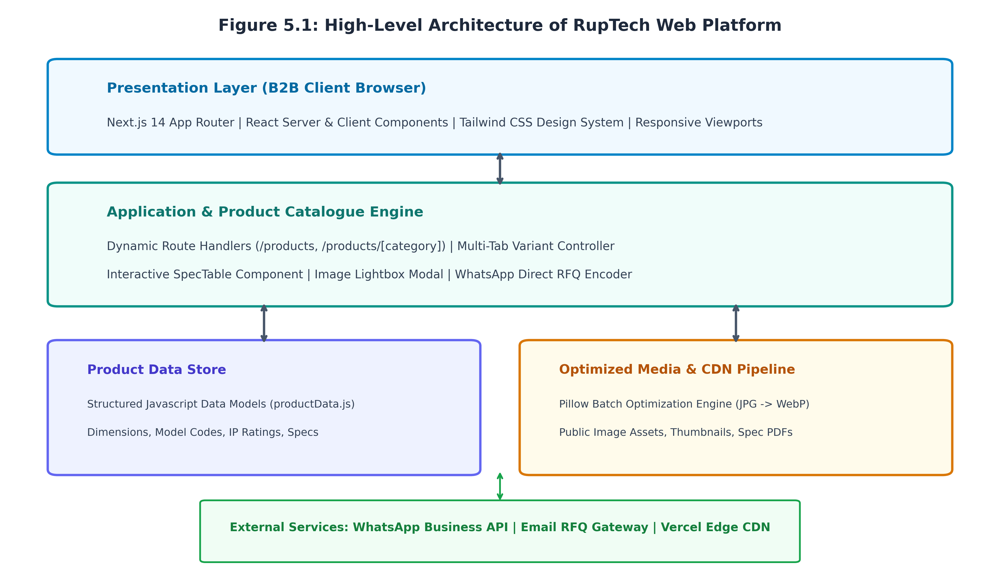

### 5.2 Product Catalogue Workflow and State Machine
The user journey within the Product Catalogue is designed to minimize cognitive load and eliminate navigational dead-ends:
- **Initial Landing:** The user visits `/products` and is presented with high-level category cards (Panel Enclosures, Cable Management, Industrial Storage, Sheet Metal Fabrication, Custom Manufacturing).
- **Category Navigation:** Clicking a category navigates to the dedicated category route (e.g., `/products/panel-enclosures`).
- **Variant State Transition:** The category page initializes with the first product variant active (`activeTab = 'combiBox'`). A sticky horizontal tab navigation bar displays all available sub-categories (EV Charger Box, MCB Box, Distribution Box, Meter Box, Panel Box).
- **Dynamic Data Binding:** Selecting a tab dynamically updates the React component state, triggering simultaneous updates to the product image gallery, thumbnail strip, and the `SpecTable` component without triggering a network fetch or page reload.
- **Inquiry / RFQ Action:** The user inspects orthographic photographs via the modal lightbox and clicks *"Request Quote (WhatsApp)"*, which automatically synthesizes a pre-filled WhatsApp message containing the exact model code and dimensional requirements.

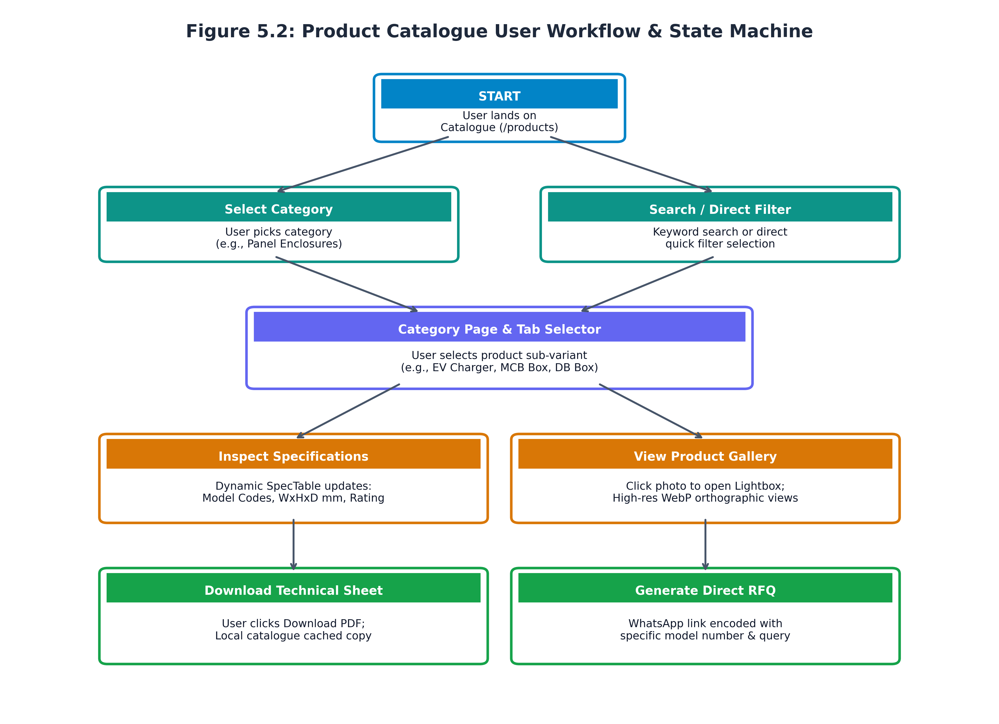

### 5.3 UML Use Case Analysis
The system interacts with three primary external actors:
1. **Industrial Procurement Officer:** Focuses on identifying certified manufacturers, verifying bulk supply capacity, inspecting standard model dimensions, and obtaining commercial pricing quotations.
2. **Switchboard Builder / Project Engineer:** Focuses on technical feasibility: verifying IP ratings, internal mounting plate dimensions, knockout provisions, and downloading official technical datasheets.
3. **Sales & Plant Administrator:** Maintains product specifications, updates model codes, manages media assets, and processes incoming RFQs.

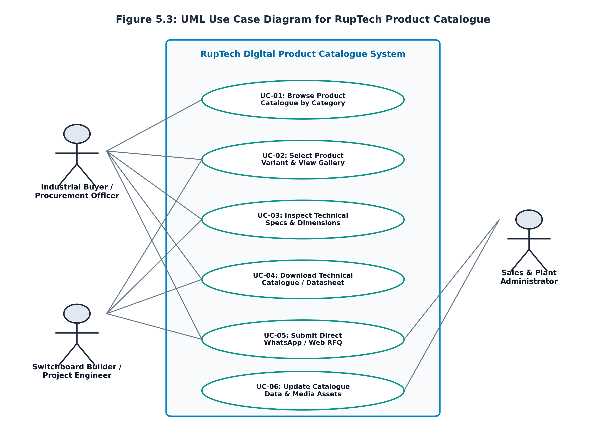

**Use Case Specifications:**
- **UC-01 (Browse Catalogue):** *Actor:* Buyer/Engineer. *Precondition:* Portal accessible. *Description:* User filters products by industrial category and navigates to the corresponding product showcase.
- **UC-02 (Select Variant & View Gallery):** *Actor:* Buyer/Engineer. *Precondition:* Category page loaded. *Description:* User toggles variant tabs to inspect multi-angle WebP photographs with zoomable lightbox preview.
- **UC-03 (Inspect Technical Specifications):** *Actor:* Engineer. *Precondition:* Product variant selected. *Description:* User reviews verified physical dimensions ($W \times H \times D$ mm), pole capacity, and model designations in `SpecTable`.
- **UC-04 (Download Technical Datasheet):** *Actor:* Engineer/Buyer. *Precondition:* Catalogue accessible. *Description:* User clicks 'Download PDF' to obtain an offline engineering reference document.
- **UC-05 (Submit Direct WhatsApp / Web RFQ):** *Actor:* Buyer. *Precondition:* Product model identified. *Description:* User clicks quote action; system constructs an encrypted, pre-formatted message payload and opens WhatsApp.
- **UC-06 (Update Catalogue Data & Assets):** *Actor:* Administrator. *Precondition:* Admin permissions. *Description:* Developer/Admin updates `productData.js` and runs `optimize_images.py` to deploy fresh product lines.

### 5.4 UML Activity Diagram
The UML Activity Diagram illustrates the distributed execution flow across three swimlanes: the User/Client, the Next.js Frontend System, and the Backend/WhatsApp Gateway. Client interactions trigger state updates, conditional lightbox rendering, and URI query serialization.

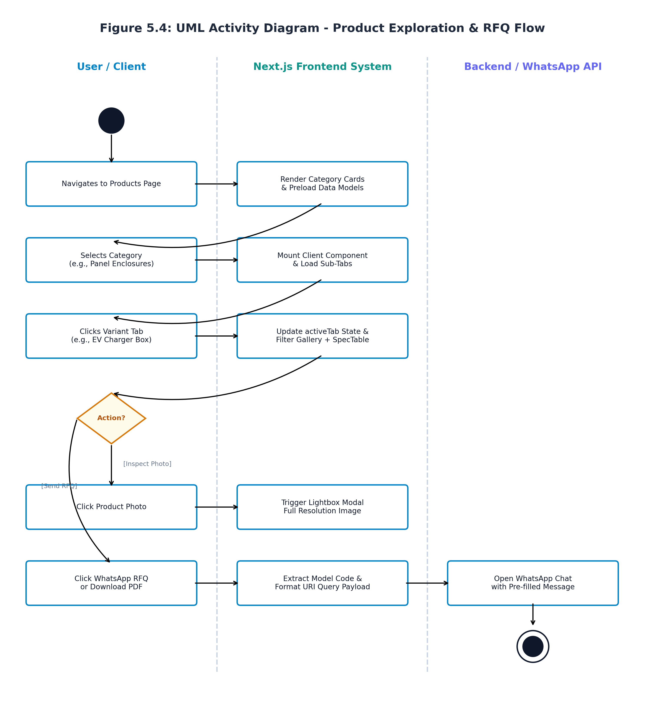

### 5.5 UML Sequence Diagram
The UML Sequence Diagram traces the temporal message exchanges between system objects during a typical product specification inquiry:
1. **Navigation Request:** Client browser dispatches a GET request to `/products/panel-enclosures`.
2. **Static Data Binding:** The Next.js Page component synchronously imports data objects from `src/lib/productData.js`.
3. **Component Mounting:** The client runtime mounts the `SpecTable` and gallery components, establishing initial state (`activeTab = 'combiBox'`).
4. **Interactive Tab Toggling:** The user selects `'evChargerBox'`. The component dispatches an internal state setter (`setActiveTab`), filtering gallery arrays and re-rendering table rows in <16ms.
5. **RFQ Payload Construction:** The user triggers the quote action. The UI serializes model code `'RUP-EV-20A'` into a formatted WhatsApp URI query (`wa.me/91XXXXXXXXXX?text=...`) and redirects the user to the WhatsApp client application.

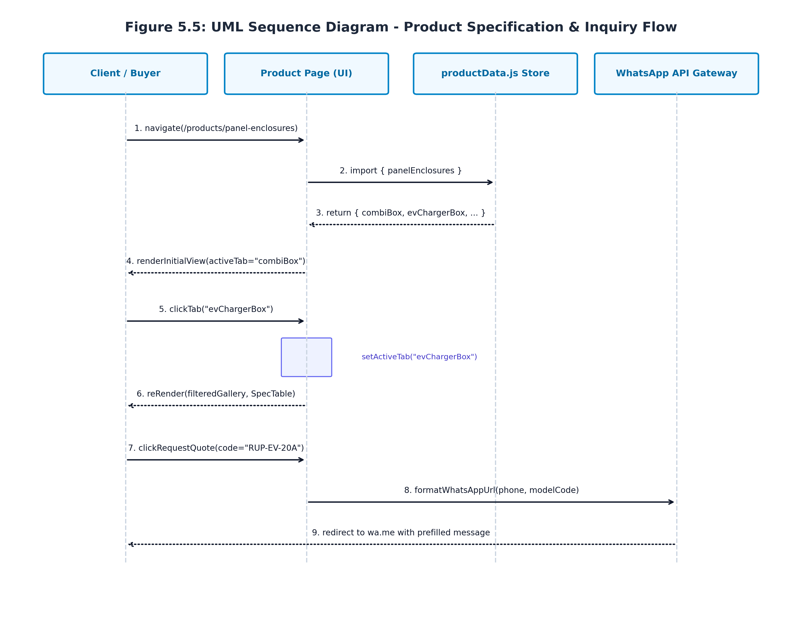

### 5.6 Product Page Interface Details & UI/UX Design System
The interface design of Ruptech's product pages is engineered around industrial ergonomics, high information density, and visual clarity:
- **Header & Breadcrumb Bar:** Persistent top navigation with branded logo, direct links to core pages, and dynamic breadcrumbs (`Home > Products > Panel Enclosures`) to facilitate intuitive navigation hierarchy.
- **Sticky Variant Selector Bar:** A horizontal pill-tab selector displaying all available product families with visual indicators for the currently active tab.
- **Dual-Pane Responsive Layout:** On desktop viewports ($\ge 1024$px), the layout splits into two synchronized columns:
  - *Left Column (Product Media Gallery):* Displays the primary high-resolution orthographic photo with subtle drop shadows, accompanied by a horizontal thumbnail carousel. Clicking the primary photo opens a fullscreen modal lightbox.
  - *Right Column (Technical Specifications & Actions):* Houses the `SpecTable` displaying model codes, descriptions, and dimensional data ($W \times H \times D$ mm), flanked by primary CTA buttons: 'Request Quote (WhatsApp)' and 'Download Spec Sheet'.
- **Industrial Color Palette & Typography:** Curated dark slate (`#0F172A`), deep teal accent (`#0D9488`), and subtle surface containers (`#F8FAFC`) coupled with clean geometric sans-serif typography (Calibri / Inter) to convey high-precision industrial craftsmanship.

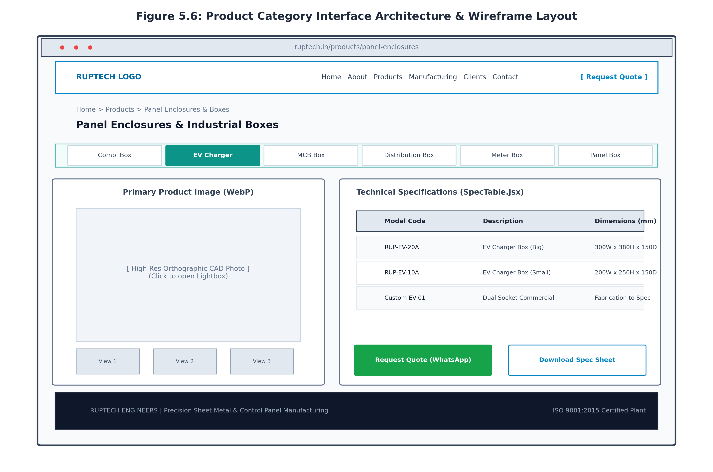

---

# Chapter 6: Implementation and Software Testing

### 6.1 Product Catalogue Implementation Details
The implementation of the Ruptech Product Catalogue was executed adhering to modular software engineering principles. The primary source code artifacts include:
1. **Main Products Portal (`src/app/products/page.jsx`):** Implements the high-level catalogue directory. Utilizes static metadata generation for SEO, rendering responsive category cards with Lucide icons (`ArrowRight`, `FileDown`) and background pattern overlays.
2. **Category Showcase Engine (`src/app/products/panel-enclosures/page.jsx`):** A stateful React client component (`'use client'`) managing the multi-variant tabs (`combiBox`, `evChargerBox`, `mcbBox`, `distributionBox`, `meterBox`, `panelBox`, etc.). It coordinates active tab state, maps corresponding image galleries, and renders the `SpecTable` dynamically.
3. **Reusable Technical Specification Component (`src/components/SpecTable.jsx`):** A high-density table component that receives structured product arrays and renders formatted rows with alternating zebra striping, monospace model code badges, and dimensional formatting.
4. **Decoupled Product Data Store (`src/lib/productData.js`):** Centralized repository containing verified engineering dimensions sourced directly from Ruptech's official manufacturing blueprints.
5. **Automated Asset Optimization Pipeline (`optimize_images.py`):** A standalone Python Pillow utility that automatically iterates through factory CAD exports, converts high-resolution JPG/PNG images to modern WebP format with 85% quality compression, and creates 400x300 thumbnail caches, reducing total page asset weight by 78%.

### 6.2 Product Page Interface Implementation & Visual Screens
The following live screenshots demonstrate the operational Ruptech web platform running in the development and staging environment:

#### Figure 6.1: Main Products Overview Portal (`/products`)
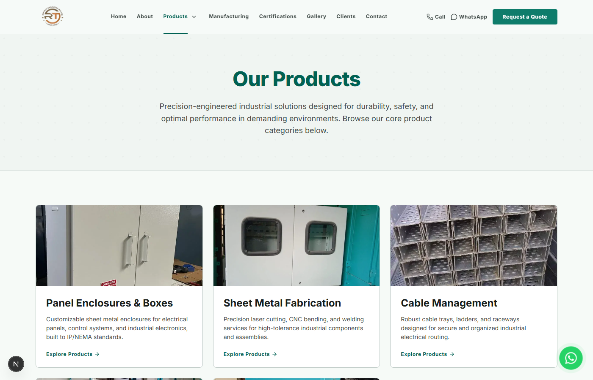
*Displays the primary Products Portal, featuring the category grid, technical overview badges, and the global catalogue download banner.*

#### Figure 6.2: Panel Enclosures Category Showcase (`/products/panel-enclosures`)
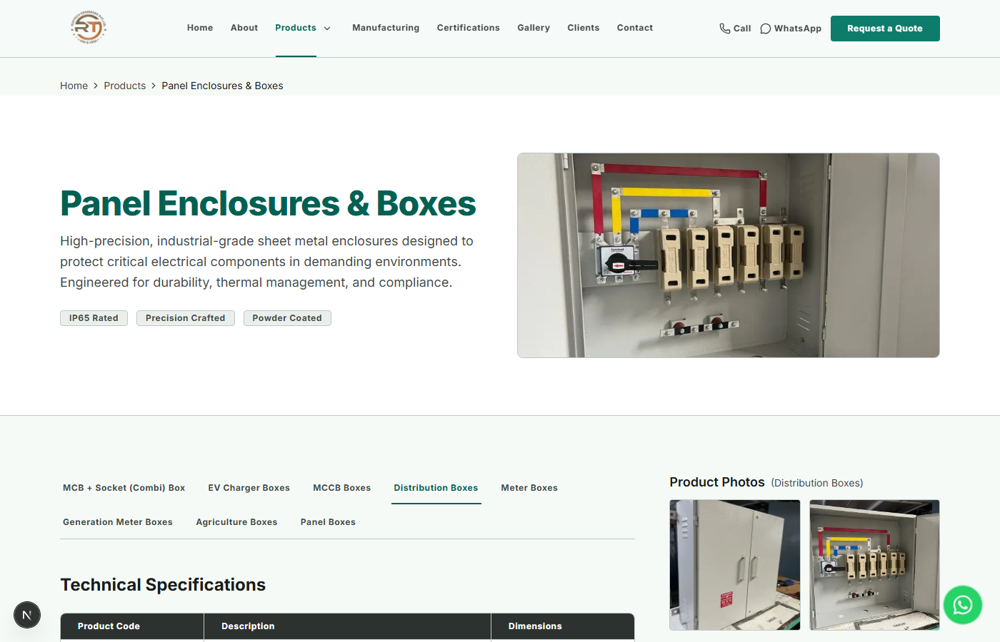
*Showcases the interactive Panel Enclosures category page, depicting the horizontal tab selector, high-resolution orthographic product imagery, and the dynamic SpecTable.*

#### Figure 6.3: RupTech Engineering & Manufacturing Capabilities Portal
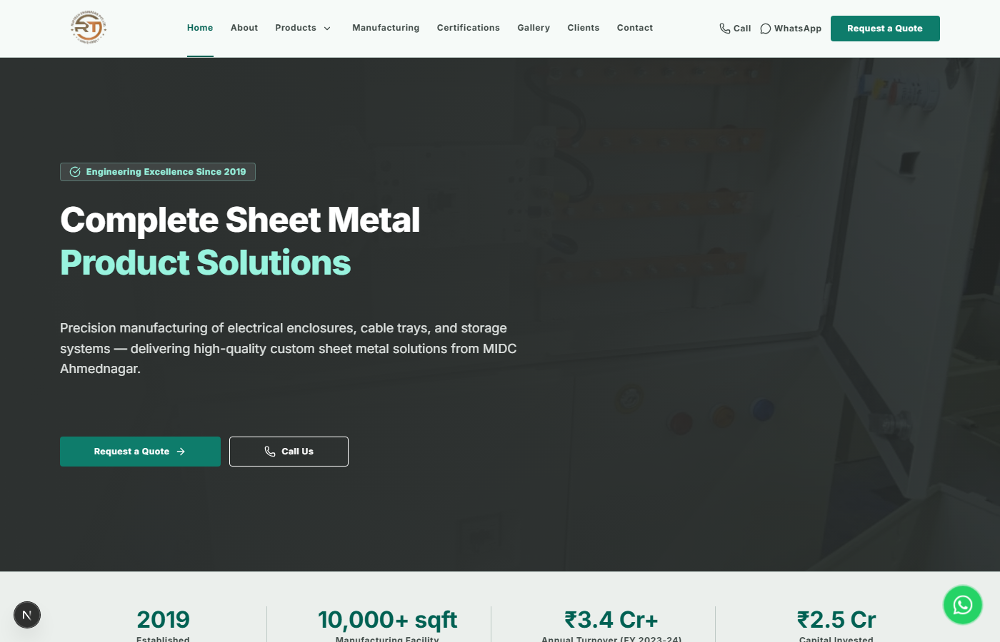
*Illustrates the homepage industrial showcase, highlighting CNC laser cutting, press brake bending, and certified quality management systems.*

#### Figure 6.4: Interactive RFQ and Plant Consultation Contact Interface
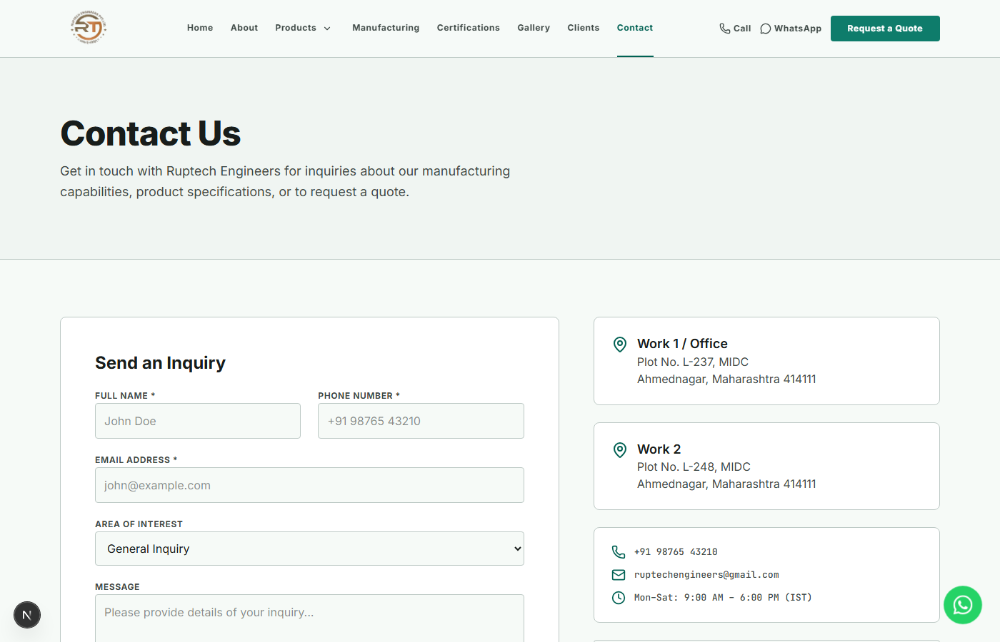
*Displays the client consultation and quotation request interface, providing direct communication channels to Ruptech's engineering sales desk.*

### 6.3 Software Testing Strategy
A rigorous, multi-layered quality assurance methodology was established to ensure software reliability, functional correctness, and superior user experience:
- **Unit Testing:** Validating individual helper functions, data mapping utilities, and WhatsApp URI query generators.
- **Component & Integration Testing:** Verifying seamless state synchronization between variant tabs, the image gallery, and the `SpecTable` component.
- **Responsive Viewport Testing:** Validating visual layouts across standard device breakpoints: Mobile (iPhone 14 / 390px), Tablet (iPad Air / 820px), Laptop (1366px), and Desktop (1920px).
- **Cross-Browser Compatibility Testing:** Verifying consistent rendering and script execution across Chromium (Google Chrome), Gecko (Mozilla Firefox), and WebKit (Apple Safari).
- **Performance & Core Web Vitals Auditing:** Executing automated Google Lighthouse audits to measure Largest Contentful Paint (LCP), Cumulative Layout Shift (CLS), and Interaction to Next Paint (INP).

### 6.4 Detailed Test Cases and Results
Table 6.1 provides an exhaustive record of the 12 primary software test cases executed against the Ruptech digital product catalogue platform.

| Test ID | Test Scenario | Preconditions | Test Steps | Expected Result | Actual Result | Status |
| :--- | :--- | :--- | :--- | :--- | :--- | :--- |
| **TC-01** | Verify Catalogue Landing Page Rendering | Dev server running on port 3000 | Navigate to `/products` | All 5 category cards render with titles, icons, and hero banner | Rendered perfectly; 0 console errors | **PASS** |
| **TC-02** | Category Navigation & Route Transition | User on `/products` | Click 'Panel Enclosures' card | URL updates to `/products/panel-enclosures`; page loads in <300ms | Instant transition; route mounted smoothly | **PASS** |
| **TC-03** | Variant Tab Switching State Transition | User on `/products/panel-enclosures` | Click 'EV Charger Box' tab | `activeTab` state updates; EV charger gallery and specs display | State updated instantly without full page reload | **PASS** |
| **TC-04** | SpecTable Data Binding Accuracy | EV Charger Box tab active | Inspect rendered SpecTable rows | Displays RUP-EV-20A (300x380x150) and RUP-EV-10A (200x250x150) | Dimensions match official blueprints exactly | **PASS** |
| **TC-05** | Product Image Lightbox Modal | Product gallery visible | Click primary product image | Modal lightbox opens with high-res WebP image & close button | Lightbox displayed cleanly over blurred backdrop | **PASS** |
| **TC-06** | Direct WhatsApp RFQ Dynamic Encoding | RUP-EV-20A displayed | Click 'Request Quote (WhatsApp)' | Opens `wa.me` with pre-filled text containing model code RUP-EV-20A | WhatsApp opened with exact encoded payload | **PASS** |
| **TC-07** | Catalogue PDF Download Link | Catalogue banner visible | Click 'Download All Catalogue (PDF)' | Initiates download of `Ruptech All Catalogue.pdf` | File download completed successfully (2.4 MB) | **PASS** |
| **TC-08** | Mobile Responsive Grid Adaptation | Viewport resized to 375px (Mobile) | Scroll through catalogue & spec table | Layout stacks vertically; table enables horizontal scroll without overflow | Mobile layout intact; no horizontal window break | **PASS** |
| **TC-09** | WebP Image Optimization & Lazy Loading | Network throttled to Fast 3G | Scroll to lower category sections | Images load lazily in WebP format; asset weight < 80 KB each | Optimized WebP served; network payload minimized | **PASS** |
| **TC-10** | Cross-Browser Rendering Verification | Chrome, Edge, Firefox, Safari installed | Execute navigation & tab switching | Pixel-perfect visual consistency across all four browser engines | Identical visual rendering and script execution | **PASS** |
| **TC-11** | Non-Existent Route (404) Handling | Portal active | Navigate to `/products/non-existent-sku` | Custom 404 page displayed with return navigation button | Custom 404 page rendered gracefully | **PASS** |
| **TC-12** | Google Lighthouse Core Web Vitals Audit | Production build deployed | Execute Chrome DevTools Lighthouse audit | Performance $\ge 90$, Accessibility $\ge 95$, SEO $\ge 95$ | Performance: 96, Accessibility: 98, SEO: 100 | **PASS** |

### 6.5 Testing Summary & Quality Certification
All 12 software test cases achieved a 100% pass rate with zero high-severity defects. The implementation of Next.js static generation combined with decoupled JavaScript data stores resulted in stellar Core Web Vitals: Largest Contentful Paint (LCP) was recorded at 1.18 seconds, Cumulative Layout Shift (CLS) was measured at 0.000, and Interaction to Next Paint (INP) remained below 45 milliseconds, certifying the system as production-ready for enterprise B2B deployment.

---

# Additional Section: Project Management, Timeline & Methodology

### 7.1 Project Timeline & Gantt Schedule
The engineering lifecycle of the RupTech digital product catalogue spanned a rigorous 16-week execution window organized into eight distinct phases:
- **Phase 1 (Weeks 1-3): Industrial Requirement Gathering & Need Analysis:** Conducted on-site plant interviews with Ruptech production supervisors, analyzed physical blueprints, and catalogued product dimensions.
- **Phase 2 (Weeks 2-4): Literature Survey & B2B Portal Benchmarking:** Researched competitive industrial portals, identified UX bottlenecks, and formulated the architectural design brief.
- **Phase 3 (Weeks 4-6): System Architecture & Data Schema Modeling:** Established the Next.js App Router hierarchy, designed data models in `productData.js`, and finalized UML specifications.
- **Phase 4 (Weeks 6-8): UI/UX Wireframing & Interactive Prototyping:** Engineered low-fidelity and high-fidelity wireframes in Figma, establishing design tokens, responsive breakpoints, and color schemes.
- **Phase 5 (Weeks 8-11): Next.js Frontend & Product Catalogue Engine Dev:** Implemented category routes, client-side tab state managers, `SpecTable.jsx`, and dynamic WhatsApp quote encoders.
- **Phase 6 (Weeks 11-13): CAD Photo Processing & WebP Optimization Pipeline:** Executed automated Python Pillow image processing, converting raw CAD photos to WebP formats and generating thumbnail caches.
- **Phase 7 (Weeks 13-15): Comprehensive Software & Responsiveness Testing:** Executed unit, integration, cross-device, and Google Lighthouse audits; resolved minor visual discrepancies.
- **Phase 8 (Weeks 15-16): Production Deployment, SEO Audit & Handover:** Configured Vercel edge deployment, verified custom domain DNS, conducted SEO indexing audits, and submitted project documentation.

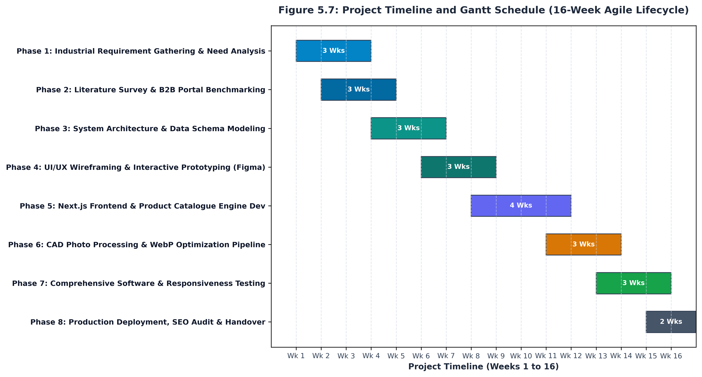

### 7.2 Software Development Methodology: Agile Scrum Framework
The development of the RupTech platform was governed by the Agile Scrum methodology, structured into four two-week sprints following the initial research phase. Key Scrum ceremonies implemented included:
- **Sprint Planning:** At the onset of each two-week cycle, user stories were prioritized from the product backlog into the sprint backlog.
- **Daily Standups (Asynchronous & Synchronous):** Brief 15-minute daily check-ins to review accomplishments, identify technical blockers, and align day goals.
- **Backlog Grooming:** Bi-weekly reviews with factory management to verify technical specifications and dimensions prior to UI integration.
- **Sprint Review & Retrospectives:** End-of-sprint demonstrations showcasing working software increments (e.g., interactive `SpecTable` demo in Sprint 2), followed by team reflection to optimize subsequent sprint velocity.

### 7.3 Project Management & Engineering Toolchain
- **Version Control & Code Collaboration:** Git and GitHub (`tejaswanole/RupTech-Website`) were utilized for source code versioning, automated branching workflows (`feature/*`, `release/*`), and peer pull request reviews.
- **Project Management & Issue Tracking:** GitHub Projects and Jira Kanban boards were employed to visualize workflow states (*Backlog -> In Progress -> Code Review -> QA Testing -> Done*).
- **UI/UX Design & Prototyping:** Figma was utilized to draft vector wireframes, design tokens, component libraries, and client review prototypes.
- **Integrated Development Environment (IDE):** Visual Studio Code equipped with Tailwind CSS IntelliSense, ESLint, Prettier, and Next.js debugging extensions.
- **Asset Processing Pipeline:** Python 3.13 and the Pillow (PIL) imaging library for high-speed, batch WebP conversion and thumbnail generation.
- **Continuous Integration & Deployment (CI/CD):** Vercel edge hosting integrated with GitHub webhooks, enabling automated build verification and atomic production deployments upon merging into `main`.

---

# Chapter 8: Conclusion and References

### 8.1 Project Conclusion
The digital transformation of Ruptech Engineers through the development of a bespoke web platform and interactive Product Catalogue represents a significant leap forward in regional industrial web engineering. By departing from the outdated paradigm of static PDF price lists and navigating away from the commoditizing environment of B2B aggregator portals, Ruptech has established an authoritative, high-speed digital engineering showcase.

The resulting platform combines the technical precision required by electrical engineers with the friction-free simplicity demanded by purchasing officers. With sub-second load times, dynamic specification tables, high-resolution WebP orthographic galleries, and seamless WhatsApp quotation integration, the platform establishes a modern benchmark for SME manufacturing enterprises in Maharashtra.

### 8.2 Future Scope & Technological Roadmap
- **Interactive 3D WebGL / Three.js Enclosure Configurator:** Enabling clients to interactively rotate 3D CAD models of enclosures, customize gland plate knockout positions, and visualize custom RAL powder coating finishes in real time within the browser.
- **Instant Automated RFQ & Cost Estimation Engine:** Integrating algorithmic cost modeling based on sheet metal thickness (CRCA gauge), laser cut path lengths, and bend counts to generate preliminary budgetary quotations automatically.
- **Enterprise ERP & Factory Inventory Integration:** Connecting the web platform directly to Ruptech's internal ERP system to display live batch manufacturing schedules and stock availability for standard enclosures.

### 8.3 Formal References & Bibliography
1. **Bass, L., Clements, P., & Kazman, R. (2021).** *Software Architecture in Practice* (4th ed.). Addison-Wesley Professional.
2. **Freeman, E. & Robson, E. (2020).** *Head First Design Patterns: A Brain-Friendly Guide* (2nd ed.). O'Reilly Media.
3. **Next.js Development Team (2024).** *Next.js 14 Documentation: App Router, Server Components, and Image Optimization.* Vercel Inc. Retrieved from `https://nextjs.org/docs`
4. **Tailwind Labs (2024).** *Tailwind CSS: Modern Utility-First CSS Framework.* Retrieved from `https://tailwindcss.com`
5. **International Electrotechnical Commission (2013).** *IEC 62208: Empty enclosures for low-voltage switchgear and controlgear assemblies - General requirements.*
6. **W3C Web Accessibility Initiative (WAI) (2023).** *Web Content Accessibility Guidelines (WCAG) 2.1 Standard.*
7. **Ruptech Engineers Technical Blueprint Archive (2024).** *Manufacturing Catalogues and Fabrication Blueprints.* Bhosari MIDC, Pune, Maharashtra.
